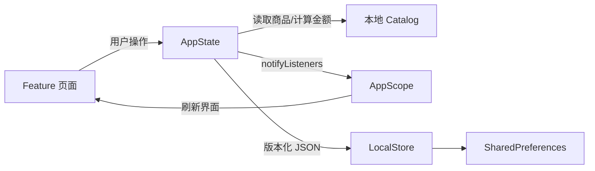

# AvoFud Flutter 项目结构与架构说明

## 1. 项目定位

依据当前 Pixso 文档 **AvoFud UI Kit** 的 Light 页面开发的 Flutter 移动应用，包含 28 个参考界面，并补充购物车、订单记录、收藏、奖励、设置和页面索引。提供深色主题。

这是可交互的本地演示应用。没有接入真实用户、短信、商户、物流或支付服务。商品、评论、统计和账户头像来自设计稿或本地演示数据，购物车和订单按实际操作更新。

## 2. 技术与依赖

| 项目 | 选择 | 原因 |
| --- | --- | --- |
| UI | Flutter / Dart，Material 基础控件定制 | 共用 Android、iOS 和 Web 页面实现 |
| 状态 | ChangeNotifier + InheritedNotifier | 直接使用 SDK，避免不必要的状态框架 |
| 导航 | MaterialApp 命名路由 | 规模明确，统一入口便于验收和截图 |
| 本地存储 | shared_preferences | 唯一运行时第三方依赖，保存轻量演示状态 |
| 图片 | Pixso 节点导出，本地 PNG | 离线可用，不依赖网络图片地址 |
| 字体 | Nunito，OFL 许可 | 未提供原稿 Cera Round Pro 字体文件，使用近似圆角字体 |
| 验证 | flutter_test、integration_test | 状态、表单、布局和 Android 端完整下单流程 |

开发环境：Flutter 3.47.7 / Dart 3.13.5。`pubspec.lock` 锁定依赖版本。

## 3. 目录结构

```text
AvoFud/
├── lib/
│   ├── main.dart                  # 初始化本地存储并启动应用
│   ├── app.dart                   # 主题、系统栏、集中路由
│   ├── core/
│   │   ├── app_state.dart         # 共享状态与业务操作、AppScope
│   │   ├── theme.dart             # Pixso 色彩与浅/深色主题
│   │   └── widgets.dart           # 页面骨架、卡片、按钮、商品行、底部导航
│   ├── data/
│   │   ├── catalog.dart           # Product 模型、本地目录、金额显示
│   │   ├── image_geometry.dart    # 独立素材的可见区域，抵消导出透明边距
│   │   └── local_store.dart       # JSON 读写适配
│   └── features/
│       ├── auth/
│       │   ├── onboarding.dart    # 启动、欢迎和三张引导页
│       │   └── auth_pages.dart    # 登录、注册、OTP、找回、语言偏好
│       ├── home/
│       │   └── home_pages.dart    # 首页、日历、统计
│       ├── shop/
│       │   ├── catalog_pages.dart # 商品列表、市场、详情、酸奶、点心、空态
│       │   └── checkout_pages.dart# 购物车、结算、成功/失败结果
│       ├── account/
│       │   ├── account_pages.dart # 账户、设置、收藏、历史、奖励、页面索引
│       │   └── wallet_pages.dart  # 钱包与创建演示卡片
│       └── discover/
│           └── discover_pages.dart# 餐厅、评论、教程
├── assets/
│   ├── images/                    # 27 个原稿独立素材
│   └── fonts/                     # 字体及许可
├── android/                       # Android 工程与品牌启动图标
├── ios/                           # iOS 工程，需 macOS/Xcode 构建
├── web/                           # Web 入口与品牌元数据
├── test/                          # 业务与 Widget 测试
├── integration_test/app_test.dart # Android 交互及实际截图
├── test_driver/                   # 将设备截图写入本地
├── tools/                         # 截图与检查辅助脚本
└── docs/
    ├── ARCHITECTURE.md             # 本文档
    ├── SCREENS.md                  # 全界面索引和截图
    ├── VALIDATION.md               # 验证结果、复现方式和边界
    ├── DESIGN_SOURCE.json          # Pixso 帧/素材节点 ID、设计 token
    ├── reference/                  # 28 张 Pixso 原稿及参考总览
    └── screenshots/                # Flutter 在 Android 上的运行截图
```

## 4. 数据流与职责



- 页面仅保存输入框、选中日期、筛选、商品规格、播放器时间等短期状态。
- `AppState` 管理购物车、收藏、登录演示状态、语言偏好、深色主题、地址、卡片和订单。添加、移除、下单等操作集中在这里。
- `LocalStore` 负责存储边界，不关心任何 Widget；使用 `avofud.v1` 作为版本化键。损坏的 JSON 回退为空状态。
- `Catalog` 保存不可变 `Product`，统一处理商品查询和金额格式，页面不重复计算总价。
- `widgets.dart` 保留跨模块确实复用的组件，不额外创建空的 Service、Repository、UseCase 抽象层。

Android Release 使用 `android/app/proguard-rules.pro` 保留本地存储插件及 JNI 需要按名称调用的 Kotlin 接口，避免 R8 裁剪这些入口；其他代码优化和未使用图标裁剪保持开启。

## 5. 购物与订单

1. 列表添加按钮将商品加入购物车，并更新购物袋角标。
2. 详情页规格使用 `商品ID|规格` 作为购物车行键，不同规格单独计数；规格不加价。
3. 购物车支持数量调整、移除，金额来自商品单价 × 数量。
4. 结算页支持修改并保存收货地址，展示动态发票与合计。
5. 成功演示支付保存订单快照后清空购物车；再次添加商品不会改变历史订单。
6. 失败演示支付保留购物车，允许返回重试。空购物车不能下单，处理中禁用重复提交。

价格使用演示整数美元；真实交易应改用整数最小货币单位，并让服务端重新校验价格、库存与签名。

## 6. 登录、偏好与媒体

- 登录接受格式正确的邮箱或手机号，以及至少 6 位密码；不保存密码、不调用真实认证。
- 注册校验手机号、邮箱与两次密码，接续本地 OTP 验证。演示验证码为 `1490`。
- 找回密码是手机号输入 → 演示 OTP → 进入应用的展示流程，没有真实重置凭证。
- 语言页保存选择偏好。界面文案保持参考稿英文，未承诺四语翻译。
- 教程页依据稿件封面实现 2 分钟分步食谱演示，支持播放/暂停、进度拖动和收藏。设计稿未提供视频文件，因此不包含真实视频或音频流。
- 日历支持切月、选日期和查看本地活动说明，不接入系统日历。

## 7. 设计映射与适配

主色 `#EE9236`，深色文字/背景 `#212432`，辅助绿 `#A9D867`。卡片圆角以 20–22 为主，页面左右留白 28，标题 22/28，正文 14/16。页面使用真实控件和独立素材，没有把整张设计截图铺成界面。

原稿基准为 375 × 812（餐厅稿为可滚动长页）。实现采用 SafeArea、滚动内容、有限宽度以及弹性网格，适配手机窄屏和 Android 键盘。Android 系统栏与原稿 iPhone 状态栏自然不同。深色模式统一背景、卡片、边框和文字色。FoodImage 根据 image_geometry 中记录的可见区域显示素材，抵消 Pixso 导出额外透明留白，原始 PNG 文件保持完整。

素材来源节点及原始帧 ID 详见 `DESIGN_SOURCE.json`。设计截图仅作为开发参考，不打入 App 素材包；`assets/images/` 中的独立素材才参与构建。Pixso 文档未被修改。

## 8. 后续接入方式

需要真实服务时，先引入用户/商品/订单 API 与认证凭证存储，再将 `AppState` 中本地演示操作替换为服务端调用。保持 Feature 页面与共享组件不变；只有调用量增长时再按认证、购物车、订单拆分状态。真实支付交给受支持的支付 SDK，禁止用 SharedPreferences 存放卡号、密码或密钥。
