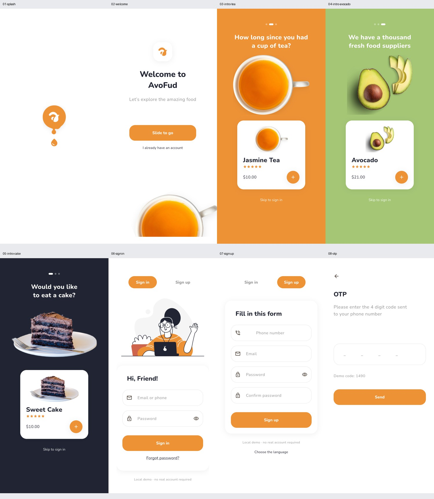
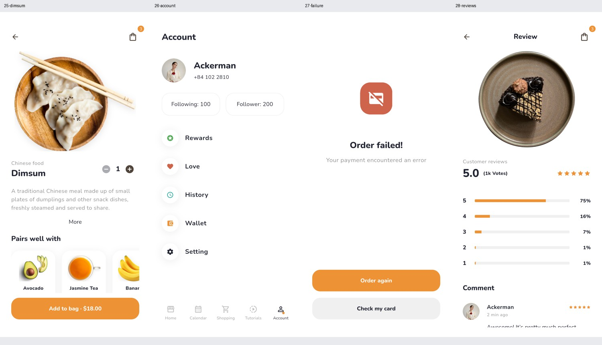

# 界面与截图索引

参考文档：Pixso「AvoFud UI Kit」。参考图是原稿导出；运行图是 Flutter App 在 Android 模拟器中的实际渲染。文件编号与 Pixso Light 帧编号一致。长内容可以在 App 内滚动查看。

## 28 个参考界面

| 编号 | 界面 | 路由 | Pixso 原稿 | Android 运行图 |
| --- | --- | --- | --- | --- |
| 01 | 启动 | `/splash` | [原稿](reference/01.png) | [截图](screenshots/01-splash.png) |
| 02 | 欢迎 | `/welcome` | [原稿](reference/02.png) | [截图](screenshots/02-welcome.png) |
| 03 | 茶饮引导 | `/intro-tea` | [原稿](reference/03.png) | [截图](screenshots/03-intro-tea.png) |
| 04 | 牛油果引导 | `/intro-avocado` | [原稿](reference/04.png) | [截图](screenshots/04-intro-avocado.png) |
| 05 | 蛋糕引导 | `/intro-cake` | [原稿](reference/05.png) | [截图](screenshots/05-intro-cake.png) |
| 06 | 登录 | `/signin` | [原稿](reference/06.png) | [截图](screenshots/06-signin.png) |
| 07 | 注册 | `/signup` | [原稿](reference/07.png) | [截图](screenshots/07-signup.png) |
| 08 | 验证码 | `/otp` | [原稿](reference/08.png) | [截图](screenshots/08-otp.png) |
| 09 | 找回密码 | `/forgot` | [原稿](reference/09.png) | [截图](screenshots/09-forgot.png) |
| 10 | 语言偏好 | `/language` | [原稿](reference/10.png) | [截图](screenshots/10-language.png) |
| 11 | 日历 | `/calendar` | [原稿](reference/11.png) | [截图](screenshots/11-calendar.png) |
| 12 | 商品详情 | `/detail` | [原稿](reference/12.png) | [截图](screenshots/12-detail.png) |
| 13 | 首页 | `/home` | [原稿](reference/13.png) | [截图](screenshots/13-home.png) |
| 14 | 水果酸奶 | `/yogurt` | [原稿](reference/14.png) | [截图](screenshots/14-yogurt.png) |
| 15 | 统计 | `/statistics` | [原稿](reference/15.png) | [截图](screenshots/15-statistics.png) |
| 16 | 生鲜市场 | `/market` | [原稿](reference/16.png) | [截图](screenshots/16-market.png) |
| 17 | 餐厅 | `/restaurant` | [原稿](reference/17.png) | [截图](screenshots/17-restaurant.png) |
| 18 | 钱包 | `/wallet` | [原稿](reference/18.png) | [截图](screenshots/18-wallet.png) |
| 19 | 结算 | `/checkout` | [原稿](reference/19.png) | [截图](screenshots/19-checkout.png) |
| 20 | 下单成功 | `/success` | [原稿](reference/20.png) | [截图](screenshots/20-success.png) |
| 21 | 创建卡片 | `/create-card` | [原稿](reference/21.png) | [截图](screenshots/21-create-card.png) |
| 22 | 教程 | `/tutorials` | [原稿](reference/22.png) | [截图](screenshots/22-tutorials.png) |
| 23 | 无结果 | `/empty` | [原稿](reference/23.png) | [截图](screenshots/23-empty.png) |
| 24 | 购物 | `/shopping` | [原稿](reference/24.png) | [截图](screenshots/24-shopping.png) |
| 25 | 点心详情 | `/dimsum` | [原稿](reference/25.png) | [截图](screenshots/25-dimsum.png) |
| 26 | 账户 | `/account` | [原稿](reference/26.png) | [截图](screenshots/26-account.png) |
| 27 | 下单失败 | `/failure` | [原稿](reference/27.png) | [截图](screenshots/27-failure.png) |
| 28 | 评论 | `/reviews` | [原稿](reference/28.png) | [截图](screenshots/28-reviews.png) |

## 运行截图总览






## 补充界面

| 界面 | 运行截图 |
| --- | --- |
| 购物车 | [截图](screenshots/extra-cart.png) |
| 设置 | [截图](screenshots/extra-settings.png) |
| 订单记录 | [截图](screenshots/extra-history.png) |
| 收藏 | [截图](screenshots/extra-favorites.png) |
| 页面索引 | [截图](screenshots/extra-gallery.png) |

## 深色主题

| 界面 | 运行截图 |
| --- | --- |
| 首页 | [截图](screenshots/dark-home.png) |
| 购物 | [截图](screenshots/dark-shopping.png) |
| 日历 | [截图](screenshots/dark-calendar.png) |
| 账户 | [截图](screenshots/dark-account.png) |
| 商品详情 | [截图](screenshots/dark-detail.png) |
| 钱包 | [截图](screenshots/dark-wallet.png) |

## 复现方式

```powershell
.\tools\capture.ps1 -Device emulator-5556
```

截图脚本先运行真实添加商品 → 购物车 → 结算 → 成功下单，再打开每个界面。为让结算页具备可验证数据，测试随后放入演示商品；历史订单因此与初始空状态不同。截图不包含调试横幅。原稿的 iOS 状态栏、字体和部分示例文案与 Android 实现存在已说明的差异。
